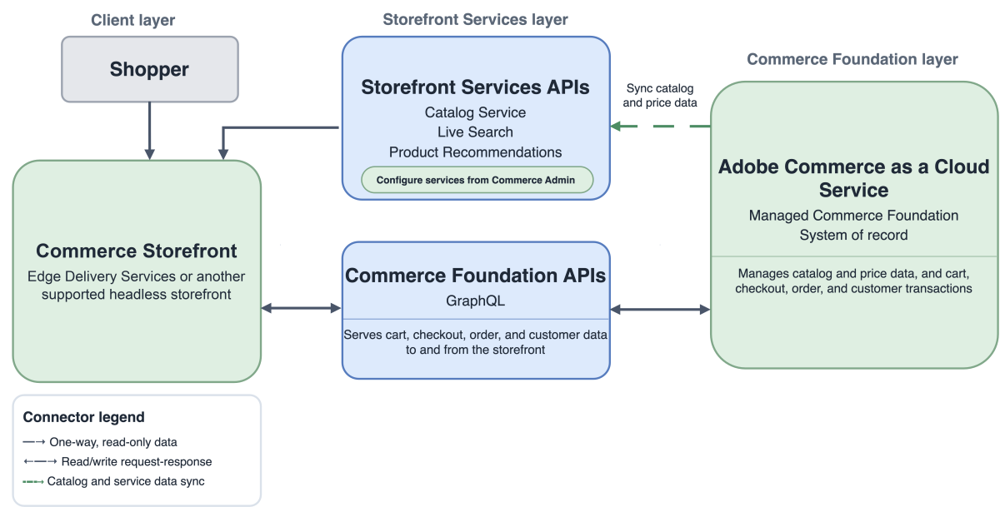

# 实施架构选项

Adobe Commerce实施架构将三个层组合在一起：商业后端（[!DNL Adobe Commerce]或[!DNL Adobe Commerce Optimizer]）、店面以及一组连接的服务和集成。 比较以下选项，确定每个架构中拥有目录、定价、购物车、结账、订单和客户交易的系统。

## 架构选项摘要

按交易所有权和店面体验比较选项。

### Commerce平台和交易

| 选项 | 记录系统 | 事务路径 | 最佳拟合 |
| --- | --- | --- | --- |
| **[!DNL Adobe Commerce as a Cloud Service]与Commerce Foundation** | Adobe管理的Commerce Foundation | 托管Commerce Foundation和连接的Commerce服务 | 希望使用Adobe管理软件即服务(SaaS) Commerce并减少基础架构所有权的客户 |
| 云中或具有&#x200B;[!DNL Adobe Commerce Optimizer Connector]&#x200B;**的内部部署中的**&#x200B;[!DNL Adobe Commerce] | 现有的Commerce Foundation，用于Commerce数据和交易 | 现有Commerce Foundation API和关联交易服务 | 希望将Optimizer发现和销售功能添加到现有[!DNL Adobe Commerce]部署的客户 |
| 具有外部商务后端的&#x200B;**独立[!DNL Adobe Commerce Optimizer]** | 现有或第三方商务平台。 目录和价格数据从外部源添加到Optimizer | API Mesh、App Builder或直接集成将店面与第三方购物车、结账、客户、订单、付款、税务、配送和履行服务相连接 | 需要Optimizer功能同时保留现有或第三方事务性商务平台的客户 |
| 云中或内部部署的Commerce Foundation **中的**&#x200B;[!DNL Adobe Commerce] | Commerce Foundation | Commerce Foundation API和配置的付款、税务、运输、库存和履行集成 | 需要完整[!DNL Adobe Commerce]平台且对云或本地基础架构具有部署控制的客户 |

### 店面体验

Storefront连接到Commerce Foundation API、Storefront Services （[!DNL Catalog Service]、[!DNL Live Search]和[!DNL Product Recommendations]）或[!DNL Adobe Commerce Optimizer]促销服务。

| 选项 | 店面体验 | 店面数据路径 |
| --- | --- | --- |
| **[!DNL Adobe Commerce as a Cloud Service]与Commerce Foundation** | 由Edge Delivery Services或其他支持的Headless体验提供支持的Commerce Storefront | Storefront Services以及用于核心平台数据的Commerce Foundation API |
| 云中或具有&#x200B;[!DNL Adobe Commerce Optimizer Connector]&#x200B;**的内部部署中的**&#x200B;[!DNL Adobe Commerce] | 使用Optimizer体验的Edge Delivery Services或自定义headless店面 | 适用于Optimizer管理的目录和促销数据的Commerce Optimizer促销服务GraphQL API |
| 具有外部商务后端的&#x200B;**独立[!DNL Adobe Commerce Optimizer]** | 由Edge Delivery Services提供支持的Commerce店面或自定义Headless店面 | 用于目录和促销数据的Commerce Optimizer促销服务GraphQL API |
| 云中或内部部署的Commerce Foundation **中的**&#x200B;[!DNL Adobe Commerce] | Edge Delivery Services、Luma、PWA或自定义headless店面 | Commerce Foundation API，以及配置后的Storefront Services |

## Adobe Commerce as a Cloud Service

{width="600" zoomable="yes"}

**键边界** — Adobe管理Commerce Foundation平台。 该架构使用Storefront Services（包括[!DNL Catalog Service]、[!DNL Live Search]和[!DNL Product Recommendations]）作为店面体验。 由AEM Assets支持的[!DNL Product Visuals]是一个可选的SaaS集成。 查看Commerce的[AEM Assets集成](../aem-assets/aem-assets-integration.md)。

**引用：**

- [[!DNL Adobe Commerce as a Cloud Service] 概述](/help/cloud-service/overview.md)
- [Commerce店面](https://experienceleague.adobe.com/en/tools/commerce-storefront/)
- [Storefront Services GraphQL架构](https://developer.adobe.com/commerce/webapi/graphql/schema/storefront-services/)

## Adobe Commerce与Commerce Foundation

{width="600" zoomable="yes"}

**键边界** — Commerce Foundation拥有Commerce平台和事务流。 [!DNL Catalog Service]、[!DNL Live Search]和[!DNL Product Recommendations]在配置时提供对目录、搜索和推荐的优化店面访问。 AEM Assets集成是可选的。 查看Commerce的[AEM Assets集成](../aem-assets/aem-assets-integration.md)。

**引用：**

- [Commerce店面](https://experienceleague.adobe.com/en/tools/commerce-storefront/)
- [COMMERCE GRAPHQL API](https://developer.adobe.com/commerce/webapi/graphql/)
- [Storefront Services GraphQL架构](https://developer.adobe.com/commerce/webapi/graphql/schema/storefront-services/)

## 带有Optimizer连接器的Adobe Commerce

{width="600" zoomable="yes"}

**键边界** - Connector将目录和价格数据从[!DNL Adobe Commerce]同步到[!DNL Adobe Commerce Optimizer]。 [!DNL Adobe Commerce]仍保留为事务系统，而Optimizer通过其Merchandising Services API提供发现和促销体验。

**引用：**

- [Commerce Optimizer集成](/help/optimizer/integrations/integrations-overview.md)
- [Commerce Optimizer促销服务](https://developer.adobe.com/commerce/services/optimizer/merchandising-services/)
- [COMMERCE GRAPHQL API](https://developer.adobe.com/commerce/webapi/graphql/)
- [Commerce店面](https://experienceleague.adobe.com/en/tools/commerce-storefront/)

## 带第三方后端的独立Commerce Optimizer

{width="800" zoomable="yes"}

**键边界** — 独立的[!DNL Adobe Commerce Optimizer]拥有目录发现和促销体验，但不拥有事务型Commerce后端。 通过数据摄取REST API输入的目录和价格数据。 Edge Delivery Services店面使用促销服务GraphQL API进行产品体验，并连接到第三方后端进行购物车和结账。

**引用：**

- [什么是Adobe Commerce Optimizer？](/help/optimizer/overview.md)
- [Commerce Optimizer数据摄取](https://developer.adobe.com/commerce/services/optimizer/data-ingestion/)
- [Commerce Optimizer促销服务](https://developer.adobe.com/commerce/services/optimizer/merchandising-services/)
- [Commerce店面](https://experienceleague.adobe.com/en/tools/commerce-storefront/)

## 术语快速参考

| 首选术语 | 含义 | 避免使用作为当前架构标签 |
| --- | --- | --- |
| **Commerce Foundation** | 基本商业和事务性功能 | 核心Commerce，PHP基础层 |
| **店面服务** | 面向店面的API，用于目录服务、实时搜索和产品推荐 | 标签限制为仅一个Commerce平台 |
| **Commerce Optimizer促销服务** | 用于目录发现和促销体验的Optimizer API | Commerce Foundation API |
| 由Edge Delivery Services支持的&#x200B;**Commerce店面** | 面向客户的店面实施 | API系列 |

## 相关指导

- [参考体系结构](reference-architectures.md)
- [选择一个Commerce选项](../portfolio/choose-commerce-option.md)
- [店面](../storefronts/overview.md)
- [API](../apis/commerce-apis.md)
