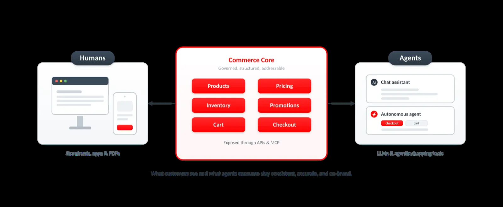

# 为购物者和人工智能代理设计商业平台

<table style="table-layout:auto">
<tr style="border: 0;">
   <td valign="middle" style="vertical-align: middle;"> <strong>Surya Lamech</strong> <em>主要产品营销经理</em></td>
</tr>
</table>

*设计一个人类和人工智能代理与单一真实来源交互的商务平台。*

Commerce正在经历结构性转变。 客户不再仅依赖搜索引擎或浏览店面来探索他们的选项。 相反，他们利用LLM支持的界面、聊天式助理和智能购物工具来提问、比较不同零售商的产品，并加快早期决策过程。

这些界面是发现、教育和比较的强大引擎。 与传统浏览相比，它们有助于客户更快速地了解需求、评估权衡和缩小选择范围。

然而，当需要完成购买时，绝大多数客户仍然更喜欢可信赖的店面和品牌所有的网站，在这些地方，支付安全性、履行透明度和购买后服务都得到了很好的理解。 在已建立信任的环境中，转化仍保持锚定状态。

重要的是，人工智能在这个阶段并没有消失。 当客户到达某个品牌的自有店面时，agentic AI可以通过指导产品选择、实时个性化推荐、回答异议、捆绑补充商品和简化结账来改善体验。 在这些可信的环境中，AI成为转化加速器，提高了完成率，并增加了平均订单价值。

为了在这种新的格局中竞争，企业需要一个&#x200B;**结构化、受管并针对人力和代理消费进行优化的商务基础**。 Adobe Commerce是为这种转变而构建的，以下原则概述了真正做好代理准备需要做哪些工作。

## 为两个受众构建的商务架构

{width="800" zoomable="yes"}

*客户看到的内容以及代理使用的内容保持一致、准确且符合品牌。*

现代商务栈栈现在必须服务于两个同样重要的受众：人员和人工智能代理。 店面和应用程序等面向人的体验对于参与、品牌表达和建立客户忠诚度仍然至关重要。 但与此同时，还有一个快速扩展的面向代理的表面：机器可读端点，为LLM和自主代理提供结构化事实、受控内容和事务性功能。

代理在处理通过可预测API提供的干净结构化数据时表现最佳，而不是尝试解释JavaScript或从表示层推断业务规则。 这意味着产品规格、定价、可用性和促销逻辑必须作为通过API和标准化界面（如MCP服务器）公开的可寻址资源而存在。 当面向人工和代理的表面均源自同一基本真实来源时，品牌可确保客户所见内容以及代理所消费的内容保持一致、准确且与品牌保持一致。

这种双面体系结构是代理商务的基础。

## 为机器推理设计的目录

{width="800" zoomable="yes"}

*一个受管辖的事实源，每个渠道均成型，且从未分叉产品数据。*

目录是代理商务的核心。 它必须为机器而构建，为合规性而管理，并且有足够的灵活性来支持所有的人和代理交互。 Adobe Commerce的目录模型是围绕目录视图、策略、层和结构化产品实体构建的，旨在满足未来需求。

目录视图定义产品数据的公开位置和方式，无论是对店面、市场、合作伙伴信息源还是AI表面。 每个视图都可以包含其各自的产品可用性、定价和属性可见性规则，从而确保将正确的信息传达给正确的消费者或代理。 目录层使您能够扩充特定渠道的产品数据，而无需修改源产品数据。 策略控制客户资格、库存逻辑、定价和法规遵从性约束。 综合起来，企业可以精确控制代理可以访问或执行哪些目录数据。

## MCP作为代理的通用语言

{width="800" zoomable="yes"}

*MCP标准化了代理以自然意图请求操作的方式，Adobe Commerce将这些操作作为受控制的确定性操作来执行。*

为了使Agentic Commerce能够执行端到端的操作，电子商务平台必须支持标准化协议，该协议允许代理安全地执行操作，例如购物车创建、结账启动、支付编排、库存验证、促销和退货。

通过对模型上下文协议(MCP)的本机支持，Adobe以LLM可以一致解释的方式构建和公开商业功能。 MCP标准化了向LLM提供产品数据、业务规则和事务上下文的方式，从而确保代理能够可靠地推理它们，同时企业可以维护治理和控制。 借助Commerce MCP，企业可以构建自定义代理体验，如购物助理、代理购物车创建、支持代理等。

开发人员MCP提供了AI支持的开发功能，使团队能够快速扩展平台功能并部署可组合的店面组件。 通过将Adobe的知识源、文档和平台最佳实践直接嵌入到开发工作流中，开发人员MCP可帮助新开发人员更快地上手，并在首次快速投入使用后提高工作效率。 它生成的代码遵循经验证的体系结构模式，易于维护，并符合企业商业所需的质量标准。 结果是加速了从思想到生产的过程，让企业比竞争者更快地实验、迭代和航运商业能力。

Adobe还致力于支持代理商业协议，如代理Commerce协议(ACP)和通用Commerce协议(UCP)，以实现产品发现和代理与店面之间的安全、基于标准的事务性交互。

通过采用开放协议而不是点集成，Adobe可确保商业交互受到管理、确定性和安全，同时启用代理到商户的新互动模型，在此模型中，可信代理可以根据明确定义的策略直接进行交易。

## 遥测和连续优化

在AI主导的生态系统中，遥测技术成为一项战略优势。 企业需要了解其品牌在LLM中的呈现方式、代理代表其内容的准确程度、代理所引用的流量如何转化，以及出现治理或法规遵从性问题的位置。 此外，它们还需要用于跟踪代理执行的操作遥测以及跨代理交互的异常检测。

Adobe使您可以看到产品在LLM中的显示方式，通过AI增强产品数据，并提高LLMS数据的可读性。 通过向您的目录添加有意义的上下文，它不仅可以帮助LLM准确地发现您的产品，还可以了解它们的性质、用途以及它们对客户的重要原因。

此外，已针对人类消费进行优化的产品详细信息页面通常包含代理无法看到的数据。 此数据可能会隐藏在模型、配置器和链接页面中。 代理可能不完全了解产品类别、捆绑包和变体。 Adobe可以识别这些关键缺失信息，并将其作为JSON-LD部署到边缘，以便代理获取所有相关产品数据。

通过这种持续的遥测和优化品牌，可以确保最大程度的知名度并保持跨LLM的竞争力。

## 为什么这很重要

电子商务不再局限于店面和搜索结果。 LLM和自主代理越来越多地协调发现、评估和事务。 这种转变改变了能见度的机制、控制的动态性以及信任的基础。 获胜的品牌将构建一个人工智能原生基础。

## 相关指导

* [目录视图](/help/optimizer/setup/catalog-view.md)
* [目录层](/help/optimizer/setup/catalog-layer.md)
* [支持](/help/optimizer/setup/policies.md)
* [Adobe Commerce App Builder的人工智能编码开发人员工具](/help/cloud-service/migration/coding-tools.md)
* [COMMERCE API](../../apis/commerce-apis.md)
* [Commerce Developer Agent播放列表](https://experienceleague.adobe.com/en/playlists/commerce-developer-agent) — 观看有关设置和使用Commerce Developer Agent的技术视频。
