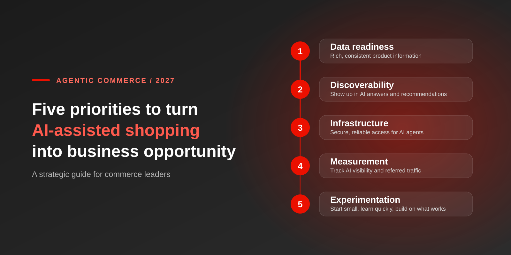

# 2027年代理商业：商业领袖的五大重点

{width="800"}

<table style="table-layout:auto">
<tr style="border: 0;">
   <td valign="middle" style="vertical-align: middle;"> <strong>Shaun McCran</strong> <em>主要产品营销经理</em></td>
</tr>
</table>

人工智能正在改变客户发现、评估和购买产品的方式。 以下五个优先事项可帮助您为商业的下一个时代做好准备。

想象一下，一位客户要求AI助手为其下一次培训课程查找最佳跑鞋。 该助手不会浏览多个网站、比较规格和检查可用性，而是帮助他们发现相关产品、根据需求评估选项，并指导他们购买。

这是一个新兴的代理商业世界，在这里人工智能代理能够支持购物决策并代表消费者采取行动。

对于品牌和零售商而言，这正在创造新的机会来吸引客户，提供更加个性化的体验，并简化购买途径。

但这也提出了一个重要问题：您的企业是否已经为人工智能代理日益影响客户的发现和购买行为做好了准备？

正如我们在2027年规划的那样，以下五个优先事项是商业领袖应该考虑的。

## &#x200B;1. 使您的产品数据为人工智能做好准备

在智能商务中，产品信息已成为您最宝贵的资产之一。

AI代理需要准确、详细和可访问的产品信息以了解您所销售的产品并根据客户需求匹配产品。

比如，一位购物者请求人工智能助手推荐一件防水夹克，以便在寒冷的天气中徒步。 要提供相关的推荐，助理需要的不只是产品名称。 它需要有关材料、天气保护、大小、可用性和价格的信息。

对于商业领袖而言，这意味着优先考虑产品数据质量，丰富产品属性，并确保信息在各个渠道之间保持一致。

>[!BEGINSHADEBOX]

**机会：**&#x200B;更好的产品信息可以帮助AI系统了解您的目录、提高产品推荐的相关性，并使客户更容易找到他们需要的内容。

>[!ENDSHADEBOX]

## &#x200B;2. 让您的产品在客户购买的任何位置均可发现

多年来，各大品牌都在搜索引擎优化方面进行了大量投资，以帮助客户找到他们的产品。

现在，AI支持的搜索和对话式购物体验正在引入新的发现渠道。

客户可能会越来越多地要求AI助理比较产品、推荐替代方案或确定满足特定需求的最佳选项。

这意味着品牌需要超越传统的搜索排名，考虑其产品在人工智能生成的答案和推荐中的显示方式。

结构化产品信息、可访问的内容、准确的可用性和清晰的产品差异都有助于支持AI发现能力。

>[!BEGINSHADEBOX]

**机会：**&#x200B;在客户购买之旅中尽早与他们联系，并创造新的机会，在您自己的店面之外与购物者建立联系。

>[!ENDSHADEBOX]

## &#x200B;3. 构建支持AI代理的Commerce基础

AI支持的发现只是历程的一部分。

随着智能商务的发展，人工智能助理可能需要与商务系统交互，以检查库存、检索定价、管理购物车和支持交易。

这就要求商业基础设施能够提供对适当信息和服务的安全、可靠访问。

例如，购物者可以要求AI助手在预算内找到笔记本电脑，检查其是否可供交付，并帮助完成购买。

模型上下文协议(MCP)等技术正在帮助建立AI代理与业务工具和服务连接的方法。

>[!BEGINSHADEBOX]

**机会：**&#x200B;创建更多互联购物体验，减少产品发现和购买之间的摩擦，同时保持适当的安全、治理和客户控制。

>[!ENDSHADEBOX]

## &#x200B;4. 重新思考如何衡量商业成功

随着购物历程的发展，企业衡量成功所使用的指标也需要不断发展。

传统的电子商务量度，如网站流量、转化率和平均订单值将仍然很重要。 但是，当客户通过AI助手发现产品时，他们可能不会讲述完整的故事。

Commerce领导人应该开始探索新的方法，以了解他们的产品在AI支持的体验中的呈现方式和推荐方式。

这可能包括监控人工智能生成的推荐中的产品可见性、产品信息的准确性、人工智能引用的流量以及这些交互对销售额的贡献。

>[!BEGINSHADEBOX]

**机会：**&#x200B;更清楚地了解新兴购物历程，并识别人工智能驱动的体验在哪些方面创造业务价值。

>[!ENDSHADEBOX]

## &#x200B;5. 开始体验AI支持的购物体验

代理商业仍在发展，企业不需要一夜之间改变一切。 采用更易于组合的商业方法可让企业以递增方式采用新的AI支持功能、加快创新并尝试新兴体验，而不会出现重组现有商业基础架构的复杂性和中断情况。

相反，2027年提供了一个从小开始、快速学习、以有效果为基础的机会。

例如，retailer可以尝试使用AI支持的购物助手，帮助客户根据需求查找产品。 时尚品牌可以探索对话式产品推荐，而消费电子产品企业可以测试人工智能辅助的产品比较。

这些实验可帮助团队了解客户期望，识别减少摩擦的机会，并在新方法中建立信心。

>[!BEGINSHADEBOX]

**机会：**&#x200B;将新兴的AI功能转变为实用的客户体验，同时为未来的创新奠定基础。

>[!ENDSHADEBOX]

## Adobe如何帮助塑造智能商务的未来

为智能商务做准备需要的不仅仅是采用单个人工智能工具。 这意味着在整个商业历程中连接产品发现、客户参与和购买体验。

Adobe正在帮助企业应对这一转变，其商业愿景围绕三个相互关联的机会构建：发现、参与和转化。

借助Adobe Commerce as a Cloud Service和Adobe的Commerce Optimizer，企业可以基于旨在支持不断演变的客户期望的现代Commerce基础而构建。

Adobe的代理商务方向包括以下功能：为AI做好准备的产品发现、通过Shopper MCP安全代理访问商务服务、AI辅助体验创建和通过Brand Concierge进行对话式购物体验。

这些创新共同致力于帮助品牌厂商提高产品可发现性、提供可信的客户交互，以及创建更加互联的购买路径。

对商业领袖来说，目标不仅仅是采用人工智能。 它就是要利用AI为客户提供更好的体验，并为业务增长创造新的机会。

## 商业的下一个时代始于你今天所做的决定

智能商务不会在一夜之间取代所有购物体验。 但它正在改变企业思考产品发现、客户参与和转化问题的方式。

成功的品牌将是那些使其产品信息易于访问、准备其商业基础结构、衡量新兴机会以及不断尝试服务客户的新方法的品牌。

商业的未来不仅仅取决于顾客的购物地点。 这是为了随时为他们服务，无论他们购物之旅从哪里开始。

>[!BEGINSHADEBOX]

**准备好让您的企业为AI支持的商务做准备了吗？**

[探索Adobe Commerce as a Cloud Service](https://business.adobe.com/cn/products/commerce.html)，了解Adobe如何帮助您打造更互联的智能购物体验。

>[!ENDSHADEBOX]

## 相关指导

* [为购物者和AI代理设计商业平台](architectural-foundations-agentic-commerce.md) — 了解如何从单一真实来源为人员和人工智能代理提供服务。
