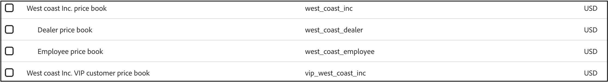

# 价格手册

价格手册定义跨客户层和市场的目录来源的产品价格。 它们支持分层模型，允许每个基本价格手册下最多三层嵌套的子价格手册。 每个价格手册均可以引用父价格手册，从而形成定价目录来源的树结构。

基本价格手册定义了它本身及其所有子价格手册的币种。 子价格帐簿将继承此币种，并且无法覆盖它。

## 重要概念

| 术语 | 描述 |
| ------ | ------------- |
| **价格手册** | 逻辑分组，定义目录来源的价格；例如，特定区域或客户层，用于管理产品价格。 |
| **备用价格手册** | 层次结构中最顶层的价格手册。 它没有父级，并且是&#x200B;*仅*&#x200B;价格手册，它定义了自身及其所有子级价格手册的货币。  如果在创建价格手册期间（通过API）未定义任何父项，则会创建一个新的备用价格手册。 |
| **父价格手册** | 一个更高级别的价格手册，如果子价格手册中没有明确设置价格，则子价格手册可以从中继承价格。 |
| **层次结构深度** | 最多三个级别（回退 — >子级 — >孙级）  在摄取时未强制执行。 |
| **货币** | 仅为后备价格手册定义。 由所有子价格手册继承。  如果在创建后备价格手册期间（通过API）未指定货币，则该货币将默认为USD。 |
| **产品价格** | 特定价格手册中分配给产品(SKU)的特定价格。 |
| **折扣** | 折扣在产品价格中定义。 未继承。 |

## 价格手册实施

价格手册实施因Commerce部署而异。

* 在具有第三方Commerce后端的Adobe Commerce Optimizer实例中，使用数据摄取REST API创建价格手册。 您可以从Commerce Optimizer Studio的“目录视图”工作区中分配和管理它们。

* 在使用可组合目录数据模型(CCDM)的Adobe Commerce as a Cloud Service中，价格手册将从Adobe Commerce目录和定价数据进行映射。 您可以从Commerce管理员中查看分配给每个目录视图的价格手册。

* 在云基础架构上的Adobe Commerce或使用Adobe Commerce Optimizer Connector进行的内部部署中，价格手册也会从Adobe Commerce目录和定价数据进行映射。 您可以从连接的Commerce Optimizer实例的“目录视图”工作区中查看分配给每个目录视图的价格手册。

## 添加价格手册

您使用价格手册API将价格手册添加到[!DNL Adobe Commerce Optimizer]。 请参阅[开发人员文档](https://developer.adobe.com/commerce/services/reference/rest/)以了解如何创建、更新和删除[!DNL Adobe Commerce Optimizer]的价格手册。

## 查看价格手册

在将价格手册摄取到[!DNL Adobe Commerce Optimizer]中后，您可以在&#x200B;**目录视图**&#x200B;页面上看到价格手册的列表及其对应的ID。

>[!NOTE]
>
>专用目录视图（启用了[!UICONTROL Catalog Protection]的视图）只能引用一个价格手册。 查看私有目录视图的[价格簿限制](private-catalog-view.md#price-book-restriction-on-private-catalog-views)。

1. 转到&#x200B;_存储设置_，然后单击&#x200B;**[!UICONTROL Catalog views]**。

1. 单击&#x200B;**[!UICONTROL Create catalog view]**。 &#x200B;

   在配置目录视图详细信息中，选择一个可用的价格手册。

   

## 配置价格手册可用性

通过为每个视图配置价格手册可用性，指定每个目录视图可用的定价数据。

1. 从&#x200B;**目录视图**&#x200B;工作区中，选择要配置的目录视图。

1. 在[!UICONTROL Price Books]部分中，选择价格手册选项以配置可用于目录视图支持的商店的定价。

1. 单击&#x200B;**[!UICONTROL Save]**&#x200B;以将更改应用到目录视图。
