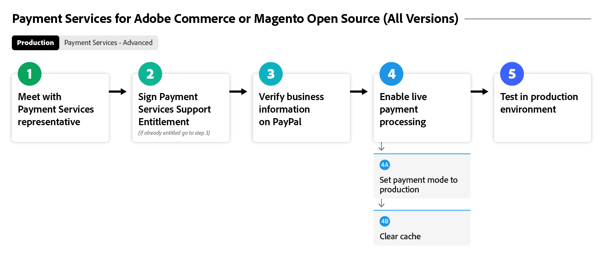
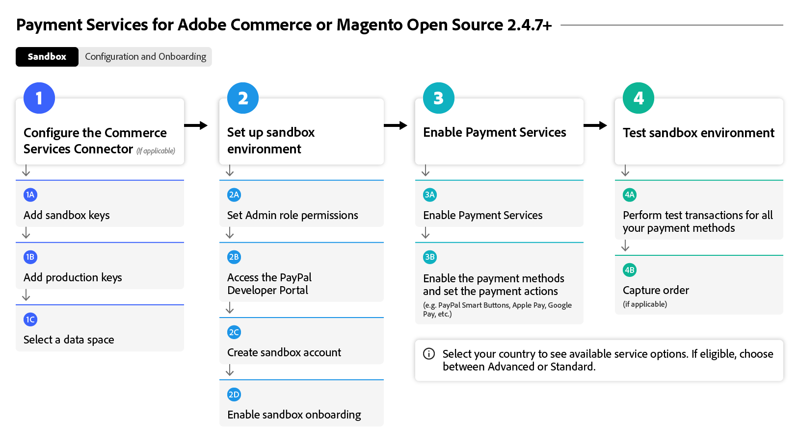
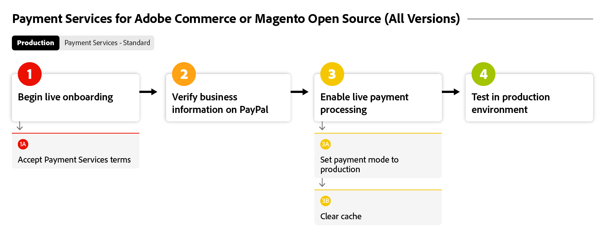
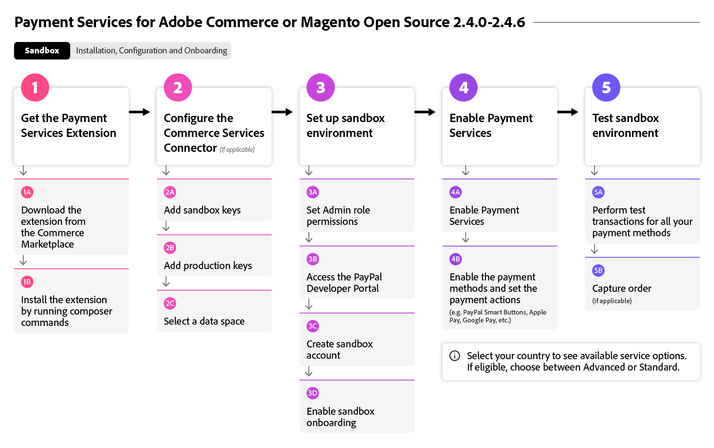

# 载入[!DNL Payment Services]流程

要开始使用[!DNL Payment Services]，您必须完成一些入门步骤。 要获得准确的指导，请选择下面最适合您组织的实例和版本的Adobe Commerce选项。

此流程图显示了所有版本中载入[!DNL Payment Services]的一般流程：

{width="700" zoomable="yes"}

请参阅下文，了解随[!DNL Payment Services]一起载入的特定Adobe Commerce版本。

## 帮助我查找我的实例和版本

### Adobe Commerce或Magento Open Source | v2.4.7+

这些流程图显示了使用比v2.4.7更新的Adobe Commerce或Magento Open Source载入[!DNL Payment Services]的一般过程。

>[!BEGINTABS]

>[!TAB 沙盒]

此流程图显示了使用比v2.4.7新版本的Adobe Commerce或Magento Open Source的载入沙盒过程，其中[!DNL Payment Services]使用Adobe Commerce进行现成处理。

{width="700" zoomable="yes"}

**版本v2.4.7+第1部分：沙盒**&#x200B;的载入步骤

1. [将您的实例](connect.md#configure-commerce-services)连接到Commerce服务。 每个Commerce实例只能完成一次此连接。 仅[!BADGE PaaS]{type=Informative tooltip="仅适用于云项目上的Adobe Commerce（Adobe管理的PaaS基础架构）。"}
1. [设置沙盒服务](sandbox.md#sandbox-onboarding)
1. 在[沙盒](sandbox.md#test-in-sandbox-environment)环境中测试付款。

>[!TAB 生产]

此流程图显示启用[!DNL Payment Services]所需的生产步骤。

{width="700" zoomable="yes"}

**版本v2.4.7+第2部分：生产**&#x200B;的入门步骤

1. 在沙盒模式下[将 [!DNL Payment Services] 设置为您的付款方式](production.md#set-payment-services-as-payment-method)以开始处理测试付款。
1. [请求支付权利](production.md#request-payments-entitlement-from-adobe)以启用实时上线。
1. [完成商家入门](production.md#complete-merchant-onboarding)以启用您的Commerce网站的实时付款。
1. [获取您的 [!DNL Payment Services] 商家ID](production.md#configure-pricing-tier)并将其交给销售人员以配置正确的定价层。
1. [在实时模式下启用 [!DNL Payment Services] ](production.md#enable-live-payments)以开始处理实时付款。
1. 在[沙盒](sandbox.md#test-in-sandbox-environment)和[生产](production.md#test-in-production)环境中测试付款。

>[!ENDTABS]

### Adobe Commerce或Magento Open Source |仅v2.4.0-2.4.6 [!BADGE PaaS]{type=Informative tooltip="仅适用于云项目上的Adobe Commerce（Adobe管理的PaaS基础架构）。"}

这些流程图显示了使用Adobe Commerce或Magento Open Source版本2.4.0到2.4.6载入[!DNL Payment Services]的一般过程。 需要下载并安装[!DNL Payment Services]才能开始载入。

>[!BEGINTABS]

>[!TAB 沙盒]

此流程图显示了使用Adobe Commerce或Magento Open Source版本2.4.0到2.4.6载入[!DNL Payment Services]所需的沙盒步骤。

{width="700" zoomable="yes"}

**版本v2.4.0-2.4.6的入门步骤第1部分：沙盒**

1. 如有必要，请[安装 [!DNL Payment Services] 扩展](install.md#get-payment-services)。
1. [获取API凭据](connect.md#obtain-api-credentials)。
1. [将您的实例](connect.md#configure-commerce-services)连接到Commerce服务。 每个Commerce实例只能完成一次此连接。
1. [设置沙盒服务](sandbox.md#sandbox-onboarding)
1. 在[沙盒](sandbox.md#test-in-sandbox-environment)环境中测试付款。

>[!TAB 生产]

此流程图显示了使用Adobe Commerce或Magento Open Source版本2.4.0到2.4.6在生产环境中启用[!DNL Payment Services]的一般过程。

{width="700" zoomable="yes"}

**版本v2.4.0-2.4.6入门步骤2：生产环境**

1. 在沙盒模式下[将 [!DNL Payment Services] 设置为您的付款方式](production.md#set-payment-services-as-payment-method)以开始处理测试付款。
1. [请求支付权利](production.md#request-payments-entitlement-from-adobe)以启用实时上线。
1. [完成商家入门](production.md#complete-merchant-onboarding)以启用您的Commerce网站的实时付款。
1. [获取您的 [!DNL Payment Services] 商家ID](production.md#configure-pricing-tier)并将其交给销售人员以配置正确的定价层。
1. [在实时模式下启用 [!DNL Payment Services] ](production.md#enable-live-payments)以开始处理实时付款。
1. 在[沙盒](sandbox.md#test-in-sandbox-environment)和[生产](production.md#test-in-production)环境中测试付款。

>[!ENDTABS]

>[!NOTE]
>
>如果您未在管理员（第1部分）中配置Commerce服务，则无法设置沙盒或实时支付。

>[!MORELIKETHIS]
>
> * [疑难解答 [!DNL Payment Services] 安装](https://experienceleague.adobe.com/en/docs/experience-cloud-kcs/kbarticles/ka-26826)
> * [PayPal沙盒帐户未验证](https://experienceleague.adobe.com/en/docs/experience-cloud-kcs/kbarticles/ka-26836)
> * [延迟 [!DNL Payment Services] 报告数据](https://experienceleague.adobe.com/en/docs/experience-cloud-kcs/kbarticles/ka-26837)
> * 在Sandbox环境中处理付款时，[在PayPal中测试信用卡失败](https://experienceleague.adobe.com/en/docs/experience-cloud-kcs/kbarticles/ka-26825)
> * [禁用 [!DNL Payment Services] 扩展](https://experienceleague.adobe.com/en/docs/commerce-on-cloud/user-guide/configure-store/extensions#manage-extensions-1)